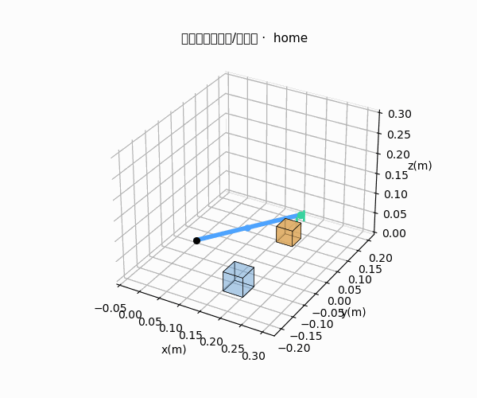
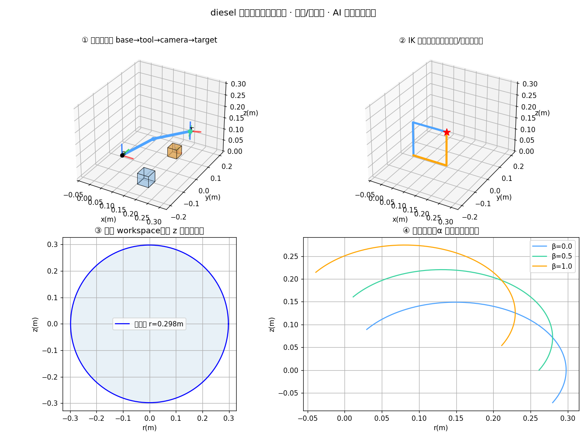

# rm-engineer-arm-sim

> RoboMaster 工程机器人机械臂 —— 个人学习记录 · 仿真工具集
> **AI 辅助搭建，本人学习记录。所有工具均为合成 / 仿真级，非实机。**

这是我学习 RoboMaster 工程机器人（三自由度水平末端机械臂）视觉抓取过程中，
逐步搭建的一套仿真工具，用来记录自己的学习轨迹。从"看懂运动学"到"跑通接电控的闭环"，
三个工具层层递进。**数学核心同源，都对齐战队的 C++ 正运动学 `level_arm.cpp`。**

## 作品展示

抓取演示（合成/仿真级，由 `scripts/make_portfolio.py` 复现）：



运动学 / 坐标链 / 可达域图解：



## 技术栈 / 能力体现

- **运动学**：三自由度正/逆运动学（余弦定理两连杆 + 多解/可达/限位），SE(3) 坐标变换。
- **手眼坐标链**：`T_base_target = T_base_tool(q)·T_tool_camera·T_camera_target`，eye-in-hand。
- **闭环仿真（SITL）**：合成相机观测注入 → 坐标链估计 → 任务状态机 → IK → 协议帧 → 仿真 MCU → 关节反馈。
- **协议设计**：仿 RoboLink 帧格式（头/类型/长度/载荷/CRC32），占位臂协议 + 编解码 + 篡改拒绝测试。
- **工程纪律**：config 驱动适配硬件、验证级别标注、单元测试（运动学/协议/闭环/抗噪/丢帧）、可复现脚本。
- **语言/工具**：C++（战队后端对齐）· Python（numpy/matplotlib）· 原生 JS/SVG（零依赖网页）· Git。

## 三个工具

| 目录 | 是什么 | 适合 |
|---|---|---|
| [`arm_sim_lab/`](arm_sim_lab/) | Python 运动学手算核对 + matplotlib 出图 | 手算 FK/IK 后核对、理解多解 |
| [`arm_sim_web/`](arm_sim_web/) | 纯 SVG 3D 网页模拟器，零依赖零联网；**含坐标链坐标系可视化 + 闭环视觉模式（合成相机+噪声）** | 双击 `index.html` 看效果、自动抓取演示、M3 坐标链 |
| [`arm_sitl/`](arm_sitl/) | 软件在环仿真平台（SITL） | 跑"相机→坐标链→IK→协议→仿真MCU→臂"闭环 |
| [`cpp_reference/`](cpp_reference/) | 实物 IK 的 C++ 参考实现 + 测试（已编译验证） | 读改调验后 port 进战队 `diesel_ws`，成为真实贡献 |
| [`docs/`](docs/) | 学习指引 + 电控臂协议需求清单 + 求职材料 | 工具↔M1-M6、手算练习、解 P0、简历/面试 Q&A |
| [`scripts/`](scripts/) | 作品集图/动图生成脚本 | 复现 `docs/figs/` 全部可视化 |

## 快速开始

```bash
# 1) 网页看效果（最简单）：浏览器打开 arm_sim_web/index.html，点"自动抓取演示"

# 2) Python 手算核对
cd arm_sim_lab
python3 arm_kinematics.py        # 核心自检
python3 arm_sim.py --verify      # 核对 3 道手算练习
python3 arm_sim.py --interactive # 滑条拖关节角

# 3) SITL 闭环
cd arm_sitl
python3 run.py --trace           # 闭环抓取放置
python3 test_sitl.py             # 全部测试
```

依赖：Python 3 + numpy + matplotlib（仅 `arm_sim_lab` 出图需要）；网页版零依赖。

## 机械臂模型

三自由度：底座 yaw `ψ` + 大臂仰角 `α` + 小臂仰角 `β`（均相对水平），连杆使末端理想保持水平。
`L1 = L2 = 0.149 m`（轴心距，待实测）。零 yaw：前 +x、左 +y、上 +z。
**三自由度只能定位置 + 水平姿态，不能任意满足六维姿态**（无腕 pitch）。

## 诚实边界（请勿过度解读）

- **合成 / 仿真级，非实机**：理想运动学，无接触力 / 动力学 / 碰撞，不是物理仿真。
- **抓取 / 放置成功是仿真结论**，不代表真实抓取能力；物体是教学立方体，不是真实识别。
- `arm_sitl` 的臂协议是**占位草案**（现有 RoboLink 只有云台帧，臂帧待电控定义）；
  手眼外参 / 杆长 / 限位 / 传动比均为占位，待实测。
- 摄像头是**合成观测注入**，不是渲染图像跑真实检测器。
- 实物 IK 的 C++ 实现仍需在战队仓库本人编写；本仓是学习 / 验证脚手架。

## 学习路线对应

详见 [`docs/学习指引.md`](docs/学习指引.md)（工具↔M1-M6 映射 + 手算练习 + 明天学习顺序）。

- `arm_sim_lab` / `arm_sim_web` → 二维两关节正 / 逆运动学、坐标链直觉。
- `arm_sitl` → 手眼坐标链 `T_base_head = T_base_tool(q)·T_tool_camera·T_camera_head`、
  抓取任务状态机、协议适配、闭环。
- 接真机的 P0 阻塞 → [`docs/电控臂协议需求清单.md`](docs/电控臂协议需求清单.md)（拿去问电控/组长）。

## License

MIT（见 [LICENSE](LICENSE)）。欢迎参考，但请保留"仿真级 / AI 辅助"的诚实标注。
